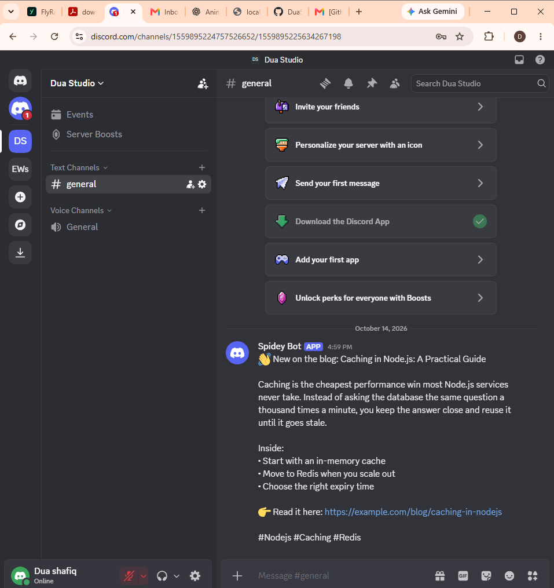

# Evidence — one proof per requirement

All test output below is from `npm test` (Node built-in test runner, `--test-reporter=spec`). Curl transcripts are from a local run with mock adapters. Probe 4 (section 8) was run against my own Discord server.

Full test run: `26 tests, 26 pass, 0 fail`.

---

## 1. Ingestion — post stored, generation reads only the stored post
`POST /posts` stores the post (`posts` table, `content_hash` UNIQUE). `generateVariants()` takes a `postId` and reads that row only.
```
$ npm run seed
Stored post 1: "Caching in Node.js: A Practical Guide"
  variant 1 [x] draft, 175 chars
  variant 2 [linkedin] draft, 955 chars
  variant 3 [telegram] draft, 459 chars
```
Ingesting the same post twice returns the same row (`HTTP 200`, not a duplicate) — test `HTTP end-to-end`.

## 2. Constraint profiles enforced by code (Probe 1 + Probe 2)
```
✔ PROBE 1: every generated variant passes its constraint profile
    blocked with: Variant for "x" breaks 1 rule(s) — x.maxLength: Variant is 331 characters; the limit is 280 (51 over)
✔ PROBE 2: an over-length X variant is blocked and the error names x.maxLength
✔ too many hashtags is blocked with x.maxHashtags
✔ tone rules: banned phrase, emojis, shouting, exclamations
✔ X counts every link as 23 characters
✔ a variant must link back to the source post
```
Curl:
```
$ curl -X POST localhost:3000/posts/1/variants/manual -d '{"platform":"x","text":"CACHING IS AMAZING!!! https://example.com/blog/caching-in-nodejs #a #b #c"}'
HTTP 422
{"error":{"code":"CONSTRAINT_VIOLATION","message":"Variant for \"x\" breaks 3 rule(s) — x.maxHashtags: Variant has 3 hashtags; the limit is 2; x.tone.maxExclamations: Tone \"punchy\" allows 1 exclamation mark(s); found 3; x.tone.noShouting: Tone \"punchy\" allows 1 ALL-CAPS word(s); found 2: CACHING, AMAZING", ...}}
```
The test also asserts the blocked variant was **not stored** (never reaches review).

## 3. Review workflow — unapproved schedule returns 4xx (Probe 3)
```
    refused with: Variant 1 is "draft". Only approved variants can be scheduled — approve it first with POST /variants/1/approve
✔ PROBE 3: scheduling an unapproved (draft) variant is refused with 409
✔ a rejected variant cannot be scheduled; an approved one can
✔ editing an approved variant sends it back to draft and cancels its slot
✔ safety gate: if a variant loses approval, its slot never publishes
```
Curl:
```
$ curl -X POST localhost:3000/variants/1/schedule -d '{"inMinutes":2}'
HTTP 409
{"error":{"code":"VARIANT_NOT_APPROVED","message":"Variant 1 is \"draft\". Only approved variants can be scheduled — approve it first with POST /variants/1/approve","details":{"status":"draft"}}}
```

## 4. Adapter layer — one interface, one real + two mocks, swap by config (Probe 6)
```
    telegram variant published via mock_x: http://test.local/mock/mock_x/posts/1
    telegram variant published via mock_linkedin: http://test.local/mock/mock_linkedin/posts/1
✔ PROBE 6: swapping telegram -> mock_x is configuration only
✔ business logic never imports a concrete adapter
✔ every registered adapter implements the SocialPublisher interface
✔ an unknown adapter name in ADAPTERS fails fast at startup
✔ TelegramPublisher calls sendMessage and builds the public message link
✔ Telegram 4xx is a definite failure; 5xx is ambiguous
```
The only change between runs is `ADAPTERS=...,telegram=mock_x` in `.env`. `business logic never imports a concrete adapter` scans `src/services/` to prove it.

## 5. Idempotent publish — same variant + slot never posts twice
```
    outcomes: published, duplicate, duplicate, duplicate, duplicate
✔ repeated publish calls for the same variant + slot create exactly one post
✔ five concurrent publish calls create exactly one post
✔ retry after a timeout (post landed, response lost) does not post twice
✔ unverifiable platform: an uncertain attempt is NOT resent blindly (at-most-once)
✔ a definite failure (e.g. bad token) is retried, then marked failed after max attempts
```
Repeated-call transcript:
```
$ for i in 1 2 3; do curl -X POST localhost:3000/slots/1/publish-now; done
HTTP 201 published  duplicate=false http://localhost:3000/mock/mock_x/posts/1
HTTP 200 duplicate  duplicate=true  http://localhost:3000/mock/mock_x/posts/1
HTTP 200 duplicate  duplicate=true  http://localhost:3000/mock/mock_x/posts/1
$ curl localhost:3000/mock/mock_x/posts   ->  count: 1
```

## 6. Durable scheduling — worker restart mid-batch, zero duplicates (Probe 5)
A real worker **process** is started with `SIM_CRASH_AFTER_SEND=1`: it posts slot 1 and dies (exit 97) before saving the result. A fresh worker then runs:
```
    [worker] slot 1: reconciled http://test.local/mock/mock_x/posts/1
    [worker] slot 2: published http://test.local/mock/mock_linkedin/posts/2
    [worker] slot 3: published http://test.local/mock/mock_x/posts/3
    [worker] drain complete
✔ PROBE 5: worker process dies right after sending; restart finishes the batch with zero duplicates
✔ graceful stop mid-batch (Ctrl+C), then restart: every slot posted exactly once
✔ a worker that dies holding a lease: another worker takes over after the lease expires
```
Graceful Ctrl+C transcript (`SIM_SEND_DELAY_MS=800`):
```
[worker] slot 2: published http://localhost:3000/mock/mock_linkedin/posts/2
[worker] slot 3: published http://localhost:3000/mock/mock_x/posts/3
[worker] SIGINT received — finishing the publish in flight, then exiting
[worker] stopped cleanly
--- restart: every key in mock_posts has count 1
```

## 7. Publish history — every attempt recorded and visible
`GET /history` (JSON), `GET /history?format=html` (table), `GET /history/summary`:
```
{"slots":[{"slot_id":1,"variant_id":1,"platform":"x","slot_status":"published","attempts":3,"successful_posts":1,"external_url":"http://localhost:3000/mock/mock_x/posts/1"}]}
```
3 attempts, 1 successful post.

## 8. Probe 4 — real publish to a free target (Discord)
Telegram is blocked on my network in Pakistan (web.telegram.org timed out in my browser), so the real target is a Discord webhook in my own server. This was a configuration change only — no code changed:
`ADAPTERS=x=mock_x,linkedin=mock_linkedin,telegram=discord`

```
PS> Invoke-RestMethod -Method Post http://localhost:3000/variants/3/approve
PS> Invoke-RestMethod -Method Post http://localhost:3000/variants/3/schedule -ContentType "application/json" -Body '{"inMinutes":2}'
[worker] slot 1: published https://discord.com/channels/1559895224757526652/1559895225634267198/1559898330711203910
```

Live message (private server, so a screenshot is included): https://discord.com/channels/1559895224757526652/1559895225634267198/1559898330711203910



## 9. Secrets clean
`.env` is in `.gitignore` from the first commit; `.env.example` lists every variable with placeholders. The Discord webhook URL and Telegram token live only in `.env` and are never logged.

## 10. README
`README.md`: what it does, architecture diagram, `docker compose up --build` (one command, seeds sample data), Node run steps, known limitations.