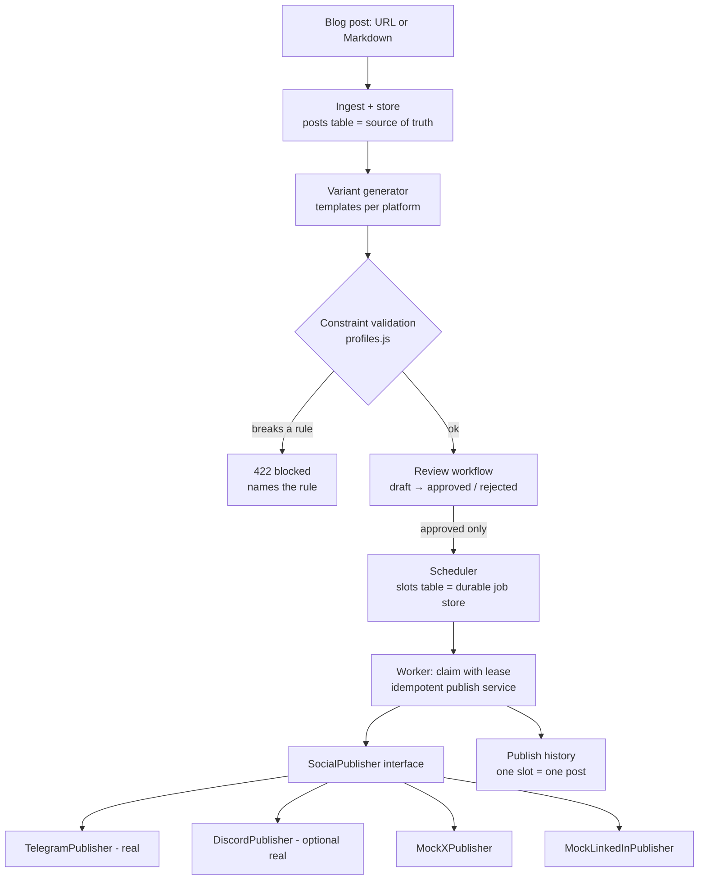

# Social Media Studio

Turn **one blog post** into a **multi-platform social campaign**. The system makes one variant per platform, enforces each platform's rules in code, lets a person approve each variant, and a durable scheduler publishes every approved variant **exactly once** — even under retries and worker crashes.

FlyRank Internship · Backend Track · Capstone. Node.js + Express + SQLite. $0, no credit card.

## What it does

1. **Ingest** a post as a URL or pasted Markdown. The stored post is the single source of truth.
2. **Generate** one variant per platform (X-style, LinkedIn-style, Telegram) from templates.
3. **Validate** every variant against its platform's constraint profile (length, hashtags, tone, link-back). A variant that breaks a rule is blocked before review, with an error that names the rule.
4. **Review**: `draft → approved | rejected → published`. Only approved variants can be scheduled; anything else gets `409`.
5. **Schedule & publish** through one `SocialPublisher` interface: a real Telegram (or Discord) adapter plus `mock_x` and `mock_linkedin`.
6. **Publish history**: every attempt and its outcome is recorded and visible.

## Architecture



```
src/
  constraints/   profiles.js (rule cards) + validate.js (enforcement)
  adapters/      SocialPublisher (interface), Telegram, Discord, Mock X/LinkedIn, registry (the only place that knows them)
  services/      ingest, generator, variants (review), scheduling, publisher (idempotency), history
  scheduler/     worker.js (poll → claim → publish)
  routes.js      HTTP API          server.js / worker.js  entry points
```

### How "exactly once" works

| Danger | Defence |
|---|---|
| Two workers grab the same slot | Atomic `UPDATE … WHERE status='scheduled'` claim with a lease. Only one caller gets `changes = 1`. |
| Retry after a timeout | `publications.idempotency_key` is `UNIQUE` (key = `variant-<id>@<slot time>`). A `sending` row is written **before** the network call. A retry first asks the adapter `reconcile(key)` — if the post is already there it is recorded, not resent. |
| Worker crashes mid-batch | Slots live in SQLite. A dead worker's lease expires and another worker takes the slot over, then reconciles any `sending` row. Ctrl+C is graceful: the in-flight publish finishes, nothing new is claimed. |
| Platform that cannot be searched (Telegram) | If delivery is uncertain, the slot becomes `needs_attention` instead of being resent (at-most-once). A human checks the channel and calls `POST /slots/:id/resolve`. |
| Unapproved content | Checked when scheduling (`409`) **and** again right before sending (safety gate). |

## Run it

**Requirements:** Node.js 22+ (or Docker). On Windows, Node 22 LTS installs `better-sqlite3` from prebuilt binaries — no compiler needed.

### Option A — one command with Docker

```bash
cp .env.example .env        # then put your Telegram token + channel in .env
docker compose up --build   # seeds a sample post, starts API (port 3000) + worker
```

### Option B — Node

```bash
npm install
cp .env.example .env        # Windows: copy .env.example .env
npm run seed                # stores samples/caching-in-nodejs.md and generates 3 draft variants
npm start                   # API on http://localhost:3000 + worker
npm test                    # 26 tests: constraints, review, idempotency, crash recovery, adapter swap
```

Run the two processes separately (handy for the crash test): `npm run api` and `npm run worker`.

### Telegram setup (real free target, ~5 min)

1. In Telegram, open **@BotFather** → `/newbot` → copy the token into `TELEGRAM_BOT_TOKEN`.
2. Create your own channel. Add the bot as **administrator** with "Post messages".
3. Public channel: `TELEGRAM_CHAT_ID=@your_channel_name`. Private channel: use its numeric id (`-100…`).
4. Keep `ADAPTERS=...,telegram=telegram`. Restart.

Discord instead? Server Settings → Integrations → Webhooks → copy URL into `DISCORD_WEBHOOK_URL`, and set `telegram=discord` (or add a platform).

## Walkthrough (curl or Postman)

Import `postman_collection.json` into Postman, or use curl (on Windows PowerShell type `curl.exe`).

```bash
# 1. Ingest (URL or markdown)
curl -X POST localhost:3000/posts -H "content-type: application/json" -d '{"url":"https://your-blog/post"}'
# 2. Generate one variant per platform
curl -X POST localhost:3000/posts/1/variants
# Probe 2: a rule-breaking variant is blocked (422, names the rule)
curl -X POST localhost:3000/posts/1/variants/manual -H "content-type: application/json" \
  -d '{"platform":"x","text":"CACHING IS AMAZING!!! https://example.com/blog/caching-in-nodejs #a #b #c"}'
# Probe 3: scheduling a draft is refused (409)
curl -X POST localhost:3000/variants/3/schedule -H "content-type: application/json" -d '{"inMinutes":2}'
# Approve, then schedule 2 minutes out (Probe 4 — variant 3 is the telegram one after seeding)
curl -X POST localhost:3000/variants/3/approve
curl -X POST localhost:3000/variants/3/schedule -H "content-type: application/json" -d '{"inMinutes":2}'
# Watch it
curl localhost:3000/slots
curl localhost:3000/history          # or open http://localhost:3000/history?format=html
curl localhost:3000/history/summary  # successful_posts is always 0 or 1 per slot
```

### Probe 5 — crash the worker

```bash
# Graceful: approve + schedule a few variants, set SIM_SEND_DELAY_MS=3000, start the worker, press Ctrl+C mid-batch, start it again.
# Hard crash after the platform accepted the post but before we saved it:
SIM_CRASH_AFTER_SEND=1 npm run worker   # exits with code 97 after the first send
npm run worker                          # resumes: "reconciled" for mocks, "needs_attention" for Telegram — never a duplicate
```

### Probe 6 — swap the adapter

Change one line in `.env`: `ADAPTERS=x=mock_x,linkedin=mock_linkedin,telegram=mock_x`, restart, schedule the telegram variant. It publishes through `mock_x`; preview at `http://localhost:3000/mock/mock_x/preview`. No code changes.

## API

| Method | Path | Purpose |
|---|---|---|
| POST | `/posts` | Ingest `{url}` or `{markdown, url?, title?, tags?}` |
| GET | `/posts`, `/posts/:id` | Stored posts |
| POST | `/posts/:id/variants` | Generate variants (`{platforms?: [...]}`); blocked ones are listed with reasons |
| POST | `/posts/:id/variants/manual` | Human-written variant `{platform, text}` — validated, `422` on violation |
| GET | `/posts/:id/variants`, `/variants/:id` | Read variants |
| PATCH | `/variants/:id` | Edit `{text}` → re-validated, back to `draft` |
| POST | `/variants/:id/approve` · `/reject` | Review |
| POST | `/variants/:id/schedule` | `{at: ISO}` or `{inMinutes}` — approved only, else `409` |
| GET | `/slots` | Calendar (`?from&to&status`) |
| DELETE | `/slots/:id` | Cancel a scheduled slot |
| POST | `/slots/:id/publish-now` | Publish immediately — idempotent |
| POST | `/slots/:id/resolve` | `{delivered: true|false, externalUrl?}` for `needs_attention` slots |
| GET | `/history`, `/history?format=html`, `/history/summary` | Publish history |
| GET | `/mock/:adapter/posts`, `/mock/:adapter/preview` | What the mocks "posted" |
| POST | `/validate` | Dry-run `{platform, text, sourceUrl?}` |
| GET | `/profiles`, `/health` | Rules and config |

## Constraint profiles

| Platform | Length | Hashtags | Tone rules |
|---|---|---|---|
| x | 40–280 (links count as 23) | 1–2 | ≤1 "!", ≤2 emoji, ≤1 ALL-CAPS word, no "click here"/"buy now" |
| linkedin | 300–3000 | 3–5 | professional: ≤1 "!", no emoji, no ALL-CAPS, no slang ("gonna", "omg", …) |
| telegram | 80–1024 | 0–3 | friendly: ≤3 "!", ≤4 emoji, no corporate jargon ("synergy", …) |

All platforms must link back to the source post when it has a URL.

## Known limitations

- Variant text comes from templates, not AI (AI is optional in the brief; enforcement is what matters). A generator for Gemini/Ollama can be added behind `generateText()`.
- The Telegram Bot API cannot look up a sent message, so an uncertain Telegram send needs a human to resolve it. This is a deliberate at-most-once choice.
- SQLite + one worker is the intended deployment. Multiple workers are safe (leases), but SQLite is not meant for many hosts.
- URL ingestion uses simple HTML extraction (`article` → `main` → `body`); unusual page layouts may need pasted Markdown instead.
- Times are stored in UTC. Send `at` with an offset, e.g. `2026-10-15T09:00:00+05:00`.
